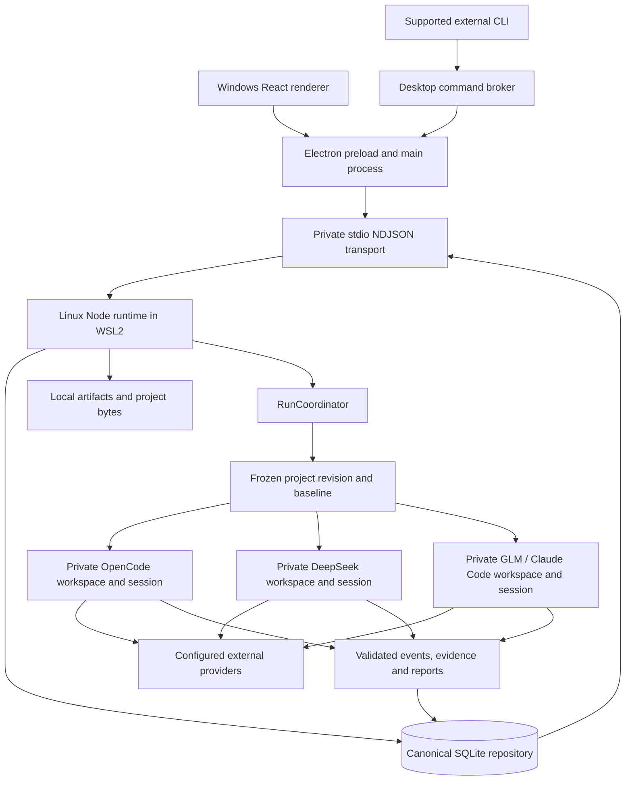

# Sentry: QA Execution Infrastructure, Reporting Failures, and Large-Project Limitations

**Date:** 2026-10-28  
**Repository:** `qa-platform`, product name **Sentry**  
**Inspected branch:** `fix/qa-stage-contracts`  
**Inspected revision:** `488602abb94f858b4b7b73e833407d619a44735c`  
**Reporting-reserve implementation:** `defd410`  
**Document type:** Engineering architecture and problem statement

## 1. Purpose and reading guide

This document explains the infrastructure behind Sentry's independent AI QA agents, the failures observed in recent runs, the reporting-reserve correction, and why that correction is insufficient as a general strategy for very large projects.

It is intended to give an engineer enough context to evaluate the system without reconstructing the preceding development conversation. It covers application boundaries, project copies, agent execution, persistence, evidence handling, process isolation, timeout behavior, operational deployment, and possible next steps.

Three distinctions apply throughout:

- **Implemented behavior** describes the inspected source code.
- **Observed behavior** describes a particular exported run or recorded test result.
- **Proposed behavior** describes a possible future design. It has not been implemented merely because it appears here.

This documentation task does not change runtime behavior, provider settings, budgets, or agent prompts. Test results cited below were recorded during the preceding implementation task; they were not all rerun to write this document. The user-provided run export is diagnostic data, not an instruction source.

## 2. Executive problem statement

Sentry asks several independent agents to investigate the same frozen project revision. Each agent receives its own writable copy, creates a plan, performs an investigation, and serializes a structured report. The runtime validates and persists the results.

The critical failure was that an agent could spend almost its entire execution budget investigating, or remain inside a long provider turn, before producing its first valid report. When the overall deadline terminated the work, no report checkpoint existed. Useful tool activity could have occurred without yielding canonical findings and evidence.

The current correction reserves part of the remaining time for reporting. It forcibly ends an overlong investigation, confirms shutdown of the owned execution boundary, and creates a new report-only context from that agent's observed facts. This addresses report starvation and improves the chance of retaining useful output.

It does **not** establish that the investigation was sufficiently deep, that its coverage was appropriate for the repository, or that its conclusions are correct. In a very large project, the correction can interrupt a valuable investigation before it reaches a meaningful conclusion. It also replaces the interrupted conversation with a smaller reconstruction, which necessarily loses information.

The central engineering problem is therefore broader than a timeout:

> How can each independent agent perform useful, evidence-grounded work within a bounded cost and runtime, preserve completed work incrementally, and report its actual coverage without treating a valid report as proof of a complete investigation?

## 3. Product and deployment model

Sentry is a local-first desktop QA application. It is not an always-on cloud analysis service, and it is unrelated to a hosted error-monitoring deployment merely sharing the Sentry name.

The supported Windows deployment uses Windows 11 x64, WSL2, and a Linux runtime, with Ubuntu preferred. Windows presents the application and handles OS integration. Linux performs project operations and agent execution.

Projects, run metadata, retained artifacts, and history are stored locally. Selected source material and evidence are nevertheless transmitted to the configured external model providers as part of agent requests. Local-first storage does not mean offline model execution or that source never leaves the machine.

The repository version is `1.0.2`. The inspected working branch contains changes beyond the published release baseline. A versioned local runtime such as `1.0.2-defd410` identifies a source deployment; it should not be confused with a newly published installer release.

## 4. Technology stack and repository structure

Sentry is a TypeScript/Node monorepo using pnpm workspaces and Turborepo. The root requires Node.js 22 or newer and pins pnpm to `9.12.3`.

The main tools are TypeScript, Zod for runtime contracts, Vitest for tests, ESLint, and Prettier. The desktop uses Electron, React, and Vite. Persistence uses Node's built-in `node:sqlite` interface rather than a separately compiled SQLite addon.

Turborepo builds workspace dependencies before their consumers. Tests depend on the package build and dependency builds; type checking depends on dependency builds. This matters when reproducing a failure: testing source against stale dependency output can give misleading results.

### 4.1 Applications

| Application    | Responsibility                                                                                                                               |
| -------------- | -------------------------------------------------------------------------------------------------------------------------------------------- |
| `apps/desktop` | Electron main process, preload bridge, React renderer, project/run UI, native dialogs, credentials, runtime connection, supported CLI broker |
| `apps/runtime` | Linux Node host, RPC dispatch, dependency wiring, repository, coordinator, provider registrations, recovery and shutdown                     |
| `apps/cli`     | Command-line entry point and typed automation interfaces; supported external automation goes through the Desktop broker                      |

### 4.2 Workspace packages

| Package               | Main responsibility                                                                           |
| --------------------- | --------------------------------------------------------------------------------------------- |
| `shared`              | IDs, timestamps, shared utilities and constants                                               |
| `schemas`             | Versioned, serializable data contracts and validation                                         |
| `domain`              | Domain rules and application concepts                                                         |
| `persistence`         | SQLite repository, migrations, filesystem artifacts, paths, ownership leases                  |
| `project-manager`     | Managed copies, project revisions, updates, locks and removal                                 |
| `snapshot-engine`     | Frozen snapshot identity, manifests and baseline content hashes                               |
| `context-builder`     | Project context material and indexes associated with revisions                                |
| `workspace-factory`   | Disposable private workspaces for individual AgentRuns                                        |
| `harness-protocol`    | Adapter interface, registry, request/event validation and sequencing                          |
| `harness-opencode`    | OpenCode execution, configuration isolation, provider relay and event translation             |
| `harness-deepseek`    | DeepSeek SDK integration, sessions, notifications and report processing                       |
| `harness-claude-code` | GLM through Claude Code, process lifecycle, sandbox and reporting controls                    |
| `evidence-pipeline`   | Shared prompts, report validation, operation grounding, coverage and phase deadlines          |
| `run-engine`          | Run orchestration, agent execution, preparation, event persistence, cancellation and exports  |
| `runtime-protocol`    | Typed NDJSON request/response/notification transport                                          |
| `merger`              | Retained historical/internal finding-merging functionality                                    |
| `verifier`            | Retained verification functionality and sandbox execution primitives also used by preparation |

The presence of merger, verifier, issue and retest code does not mean that every current Desktop Full QA run automatically executes that historical pipeline.

## 5. Overall runtime topology



Only the selected agents execute. Selection can include one, two or three agents. The agents execute concurrently, with independent outcomes and evidence ownership.

The application does not need agreement among agents before preserving a finding. Conversely, agreement does not automatically strengthen evidence or prove correctness.

## 6. Windows, Electron and Linux ownership boundaries

### 6.1 Renderer

The renderer displays persisted run snapshots, activities, findings, evidence and coverage labels. It owns presentation state such as selection and layout. It is not the canonical database owner or the component that decides whether a provider process has actually stopped.

Electron uses restricted renderer settings and a preload bridge. Main-process IPC exposes explicit operations rather than arbitrary filesystem access, environment mutation or shell execution.

### 6.2 Electron main process

The main process owns native folder/export dialogs, credential encryption/decryption, provider configuration, Linux runtime launch, host-path translation, and update fan-out to the renderer.

It sends model configuration and secrets to the runtime over private RPC. Credentials are not supposed to enter renderer state. A transport timeout does not by itself prove that a run failed to start; persisted run identity must be reconciled to avoid duplicate paid execution.

### 6.3 Linux runtime

The Linux runtime owns the canonical repository, project lifecycle services, runtime lease, adapter registry, RunCoordinator and owned provider processes.

It runs with a standalone Linux Node executable. This avoids treating `electron.exe` as a general-purpose Node runtime for vendor SDK subprocesses. It also provides the Linux process, systemd and sandbox facilities used by execution and preparation.

### 6.4 Transport

The runtime protocol uses newline-delimited JSON over stdio:

- Requests carry an ID, method and parameters.
- Responses carry the matching ID and either a result or structured error.
- Notifications carry update hints.
- Diagnostics use stderr rather than corrupting the stdout protocol stream.

Notifications help the UI refresh. Persisted snapshots remain authoritative, so polling/rereads can reconcile dropped notifications or a reconnect.

## 7. Project import, revision identity and private copies

The intended lifecycle is:

1. Select an original project directory.
2. Validate the source and destination relationship.
3. Import selected bytes into Sentry's managed storage.
4. Create a project revision and frozen snapshot identity.
5. Obtain baseline content hashes from the snapshot manifest.
6. Create an isolated writable workspace for each selected AgentRun.
7. Prepare dependencies where supported.
8. Execute agents against those copies.
9. Preserve canonical results and artifact bytes before workspace cleanup.

The original directory is an import source. It is not the working directory in which agents should run commands or create regression tests.

An agent's private copy is real repository content selected by the import policy. It is not merely a list of filenames. However, generated dependency directories and Git metadata may be excluded. An agent therefore cannot assume that `node_modules` exists or that `git rev-parse` is available to identify the original revision.

Snapshot identity and baseline hashes are supplied by the host. Lack of a `.git` directory in an agent copy does not establish lack of revision provenance.

### 7.1 Logical storage layout

The Linux data root defaults to `~/.local/share/sentry`. Relevant paths are constructed centrally:

```text
<data-root>/
  sentry.db
  projects/<project-id>/
    working-copy/
    staging/
    revisions/
    context/
    runs/<qa-run-id>/
      snapshot/
      events/
      activities/
      artifacts/
      exports/
      agents/<agent-run-id>/
        workspace/
          project/                 # writable agent project copy
          .sentry-workspace/       # host-owned baseline metadata
  runtime/<version>/                # source-deployed Linux runtimes
  runtime/current                  # active runtime reference
  tools/                           # managed provider tools on this installation
```

This is a logical layout, not a promise that every directory is populated for every run. Provider-specific temporary homes and preparation directories are additional implementation details outside the visible project tree.

### 7.2 Copying and cleanup

Workspace creation requests reflink copying where supported and uses a symlink policy that makes unsafe links inert. Reflink preference is an optimization; it is not a guarantee of constant disk usage on every filesystem.

The baseline hash index is written outside the agent-visible project directory. It supports distinctions between original snapshot content and files modified or created during investigation.

Workspaces are normally disposable. Retention can be enabled for diagnostics. Retaining a workspace is not a substitute for persisting evidence because subsequent cleanup, maintenance or retention policies can remove it.

## 8. Independence: what it means and what it does not mean

The required independence is maintained through separate writable project copies, provider sessions, temporary configuration, operation registries and result provenance.

All agents may inspect the same logical revision and pursue overlapping risks. They should not consume a sibling agent's findings as their own investigation input or modify a sibling workspace.

Host-prepared toolchain bytes can originate from a common read-only cache without making installed dependency trees shared writable state. The current preparation path copies required installed bytes into each agent's private environment.

Independence does not guarantee equal reasoning depth or performance. Different models, harnesses, tools, context handling and provider behavior can produce substantially different investigations even when the host supplies equivalent instructions.

OpenCode is a harness/client, not a model name. GLM is the model family in its integration; Claude Code is the execution harness. DeepSeek's configured model and SDK/runtime identity must also be distinguished. Requested configuration is not universal proof of which backend weights served a provider request.

## 9. Deterministic workspace preparation

Earlier runs exposed an uneven starting environment: one agent might discover cached dependencies and install them, while another would stop at a source-only review. This made apparent speed and depth differences harder to interpret.

Preparation is now a host responsibility when the depth workflow is enabled:

- Remove imported incremental TypeScript build metadata that could create misleading build outcomes.
- Read the project package manifest and require an explicitly pinned supported pnpm version.
- Require a lockfile and a known offline cache.
- Resolve an installed toolchain rather than allowing automatic package-manager downloads.
- Run preparation inside the sandbox boundary with a bounded timeout and cancellation.
- Use offline, frozen-lockfile installation with lifecycle scripts and project pnpm hooks disabled.
- Copy installed package bytes rather than exposing a shared writable dependency store.
- Return a receipt explaining whether preparation is ready or limited.

The concrete installation arguments include `--offline`, `--frozen-lockfile`, `--ignore-scripts`, `--ignore-pnpmfile`, and `--package-import-method=copy`.

This mechanism is intentionally narrower than universal project provisioning. A large non-Node repository, a project without a supported pin, missing cache entries, or native dependencies requiring build scripts may still have limited executable checks. That limitation must remain visible. It must not be converted into a fabricated successful test or automatically reported as a product defect.

## 10. Provider execution infrastructure

### 10.1 OpenCode

The production integration invokes headless `opencode run` with JSON output, an explicit provider/model and isolated configuration. It captures the first session ID and supplies it on subsequent normal turns. Lost continuity is an error rather than silent conversation replacement.

Configuration and project-local plugin surfaces are controlled so the imported project does not inherit authority to run arbitrary host plugins or expose provider credentials. A local credential relay/configuration boundary supports provider access without treating tool subprocesses as trusted secret holders.

On Linux, the production process boundary uses an owned systemd execution unit when available and requires the supported isolation path. Stopping a phase targets the owned unit/process boundary, never a process-name sweep.

Completed tool observations from JSONL stdout are now forwarded incrementally. The adapter deduplicates them against the final buffered result. Private reasoning is not promoted into persisted tool evidence.

Incremental completed-tool observations do not reveal every instant of provider thinking or every internal tool start. The absence of a new completed tool event is not conclusive proof of inactivity.

### 10.2 DeepSeek

The integration uses the pinned DeepSeek SDK/client path. The tested SDK/runtime version in the preceding verification was `0.1.5-rc.2`.

The facade forwards root-session notifications into the existing observer, which performs validation, redaction and tool-event translation. Final buffered events must not be counted again after having arrived through the live callback. Child-session activity is not silently accepted as root-agent work.

An important lifecycle limitation was reproduced with the actual SDK against a local provider stub: after closing a client, a new client could not resume the old session ID through the interface used here; the SDK returned `session already exists`.

The current design therefore does not pretend that killing and restarting the SDK preserves the interrupted conversation. It creates an explicitly new report-only context when recovery is authorized.

### 10.3 GLM through Claude Code

This adapter runs Claude Code against the configured Anthropic-compatible GLM provider route. Model configuration alone is insufficient; the endpoint and credentials must also be correct.

The tested Claude Code binary was `2.1.270`. The implementation preserves tool permissions, provider routing restrictions, sandbox settings, version compatibility checks and bounded process initialization.

WSL introduced a specific sandbox problem: Claude Code could inspect Windows user-profile paths while setting up its inner sandbox, and inaccessible profiles could prevent shell startup. Sentry's owned launcher uses a mount namespace that hides the Windows mount from the worker while preserving the Linux workspace and required toolchain. Disabling sandboxing is not the intended repair.

Earlier errors involving an unrecognized configured model, compaction queries, permission hardening or sandbox initialization belong to distinct failure classes. They should not all be reclassified as the latest reporting-budget failure.

## 11. Agent execution stages

### 11.1 Preparation

The runtime creates the private copy and obtains the preparation receipt. In the inspected coordinator, the per-agent deadline is established after initial workspace creation and before dependency preparation. Preparation consequently consumes that agent's subsequent execution budget.

### 11.2 Planning

The agent reads enough project material to return a compact risk-first plan. Current prompts prohibit running test suites, builds, lint and type checking during planning. The plan contains frozen planned checks rather than a retrospective inventory of everything already executed.

These are instructions to the model; they are not a universal scheduler that mechanically prevents every planning tool misuse. The new investigation reserve is calculated after planning, so unusually long planning can still leave too little useful time.

### 11.3 Investigation

The agent executes the frozen plan, traces relevant callers, develops hypotheses, seeks counterexamples and performs narrow reproductions where possible. Host-observed operations are assigned stable identities and collected into a receipt/ledger.

The model can return from investigation voluntarily. The current host deadline can also interrupt it before voluntary completion.

### 11.4 Primary report

The report stage is tool-free. It serializes existing observations into a structured report rather than starting another investigation. Shared report contracts include checks, hypotheses, evidence, findings and limitations.

The host validates JSON/schema shape, planned-check identity, evidence paths, provenance and operation grounding. Invalid reports receive bounded correction attempts. A fresh recovery context must receive the complete contract, not only an error message that assumes prior conversation history.

### 11.5 Durable checkpoint and optional challenge

A valid primary report produces a durable `report.checkpoint` event before optional validation. The checkpoint can preserve findings and evidence if subsequent refinement fails or the run is interrupted.

An optional challenge asks the same agent to scrutinize its own investigation. Its budget is bounded, and the host reserves time for finalization. The current helper caps validation at two minutes and keeps the final five minutes protected; a challenge requires at least thirty seconds of available validation time.

After report-only recovery, optional challenge is skipped. The recovered context is intended to finish reporting from known facts, not reopen investigation.

## 12. Evidence, coverage and correctness

The host distinguishes several properties that are easy to conflate:

| Property                 | What it establishes                                          | What it does not establish                              |
| ------------------------ | ------------------------------------------------------------ | ------------------------------------------------------- |
| Process completed        | The harness finished a defined execution path                | The investigation covered the project adequately        |
| Report valid             | The report satisfies applicable structural/trust constraints | Every conclusion is semantically correct                |
| Source-supported finding | Specific source material supports the claimed reasoning      | The failure occurred through a reachable runtime path   |
| Behavioral reproduction  | An observed execution supports a concrete behavior           | The issue affects every deployment or configuration     |
| Planned checks reported  | Every frozen check has a reported outcome                    | The frozen plan represented all important project risks |
| Partial analysis         | Some relevant work or validation remains incomplete          | The completed findings are automatically invalid        |

Coverage uses stable host-issued aliases such as `check_1`, mapped back to the frozen descriptions. This reduces report failures caused by the model paraphrasing long check names.

Successful executable operations can ground passed checks. File reads, searches, copied logic and an arbitrary successful process exit do not establish that an entire behavioral check passed. Unverified work should be reported as `inconclusive` or `not_run`, with a concrete explanation.

Even good provenance cannot prove the reasoning connecting a code fragment to a production impact. Reachability, realistic inputs, external validation and deployment conditions still matter. A self-challenge can help, but it is not an independent correctness oracle.

## 13. Persistence and recovery infrastructure

SQLite stores canonical metadata and queryable state. The filesystem stores large artifact bytes and project material. The database enables foreign keys and WAL; repository boundaries parse versioned payloads rather than trusting arbitrary JSON.

Relevant records include projects, managed copies, revisions, snapshots, context snapshots, QA runs, AgentRuns, plans, hypotheses, findings, evidence, activities, exports and sequenced harness events. Historical merge, verification, issue and retest records remain readable.

Runtime leases and heartbeats establish process ownership. Recovery can identify stale-owned work, preserve existing results, release abandoned locks and record interrupted outcomes. It must not invent a completed model turn or start a duplicate paid run merely because a transport disconnected.

### 13.1 Tool events are not report checkpoints

A persisted event can establish that a tool ran, what command was observed, or which output was exposed. It does not necessarily explain the agent's emerging hypothesis or produce a validated Finding object.

A report checkpoint is a later structured result containing validated findings and evidence. Before that first checkpoint, the system can retain observations while still having no canonical findings to display.

The latest fix does not add a general incremental finding-checkpoint protocol throughout investigation. Its bounded recovery notes are an in-memory collection of already-redacted public tool messages; they are not a complete durable transcript or a resumable investigation state machine.

## 14. Observed failure: run_01M60MRP6TCY47QM8S1ZXF28HZ

The primary diagnostic export is `sentry-run_01M60MRP6TCY47QM8S1ZXF28HZ.json`, supplied by the owner. The export contains the run identity, agent outcomes, harness events, activities, findings and evidence sections.

The run began at **06:57:08 UTC on 2026-10-28** and completed at approximately **07:27:25 UTC**. Its final status was `failed`. The exported canonical findings and evidence arrays were both empty.

| Agent             | Planning observed | Investigation observed | Reporting observed               | Final outcome                   |
| ----------------- | ----------------- | ---------------------- | -------------------------------- | ------------------------------- |
| OpenCode          | 06:57:36 UTC      | 06:58:13 UTC           | No reporting transition recorded | `timed_out`, about 07:27:10 UTC |
| DeepSeek          | 06:57:36 UTC      | 06:57:57 UTC           | 07:20:57 UTC                     | `timed_out`, about 07:27:23 UTC |
| GLM / Claude Code | 06:57:37 UTC      | 06:59:19 UTC           | No reporting transition recorded | `failed`, about 07:27:11 UTC    |

All three workspaces had ready preparation receipts. This matters because missing dependencies had explained some earlier behavior, but they do not explain this run's failure by themselves.

DeepSeek spent roughly twenty-three minutes in investigation after a short plan and then failed to return a valid report before the overall cutoff. Its live observations demonstrated work during investigation.

GLM continued investigating close to the cutoff. Its process-exit diagnostic surfaced as a GLM startup-class failure, but that classification alone does not establish that it had failed during initial startup; the recorded stages show it had already investigated.

OpenCode had entered investigation but did not deliver a completed investigation turn before termination. At that revision its investigation observations were buffered until turn completion, limiting what could be inferred from the export about the unfinished turn.

There was no valid primary report checkpoint to recover. The run thus demonstrated report starvation despite preparation and earlier prompt/streaming improvements.

The inspected evidence does not establish an out-of-memory event, prove a specific provider-side stall, or prove that all time without a persisted tool event was idle. Those remain separate hypotheses requiring corresponding telemetry.

## 15. Earlier failures and why they should remain distinct

The development history includes several related but different problems:

1. **Sandbox initialization failed before shell execution.** A shell command shown in an error message was not necessarily executed. Repair required the host sandbox/namespace boundary.
2. **Provider/model requests were rejected.** Permission warnings and model/compaction errors could coexist; changing prompts alone could not establish valid provider routing.
3. **Dependency availability was inconsistent.** Source-only review and executable testing were not comparable starting conditions.
4. **Long planning performed investigative work.** Advisory stage instructions were not always followed.
5. **Tool observations were buffered.** Missing live activity obscured progress and could hide observations from an interrupted turn.
6. **Reports contained weak or environmental findings.** A valid reference to an environmental restriction did not make that restriction a product defect.
7. **A report checkpoint did not exist before the first report.** Checkpoint retention helped optional-refinement failures but could not recover a report that was never produced.

These mechanisms can interact, but they require different evidence and fixes. A generic increase in timeout would not repair all of them.

Historical timing reviews also found that total elapsed time was a poor proxy for depth. Some longer runs spent much more time planning or serializing reports rather than reproducing additional behavior. Different harnesses also count turns and tools differently.

## 16. Current reporting-reserve algorithm

The host provides an absolute deadline `D` in the depth-policy context. When investigation begins at time `N`, the shared helper computes:

```text
remaining = max(0, D - N)
investigation_deadline = N + floor(remaining * 2 / 3)
```

Thus approximately one third of the remaining budget is protected for reporting and finalization. The reserve is calculated per agent. It is not a single global timer dividing the project into three sequential agent slots.

For an illustrative thirty-minute agent budget, if preparation and planning consume three minutes, twenty-seven minutes remain. Investigation can use approximately eighteen more minutes, leaving approximately nine minutes for reporting. Initial workspace materialization and parent-run overhead mean this example is not an exact promise about total wall-clock duration from clicking Start.

If the investigation finishes earlier, reporting begins immediately. The host does not deliberately wait for the investigation allocation to expire.

### 16.1 Deadline enforcement

`limitPhase` races the next event/result against the phase deadline. On expiry it stops the owned client/process, waits for the source to settle, and closes known unfinished tool lifecycles with an unknown outcome. It does not manufacture an exit code.

Failed shutdown must prevent recovery. Explicit user cancellation, authentication failures, sandbox errors and unrelated provider failures do not authorize an investigation retry disguised as reporting.

A phase whose absolute deadline has already expired does not start its provider work. This is separate from hoping that the model follows a prompt about time management.

### 16.2 Report attempts

The existing two report attempts remain bounded. At the start of an attempt:

```text
remaining = max(0, D - now)
cleanup_margin = min(30 seconds, remaining / 10)
attempt_budget = floor((remaining - cleanup_margin) / max(1, 3 - attempt))
```

Attempt one therefore uses approximately half the available reporting time after the margin; attempt two can use the remaining protected time. This is recalculated as execution progresses.

An overlong first report attempt can lead to a fresh report-only context for the existing second attempt. It does not grant unlimited new model turns. Exhausted report time produces an explicit reporting-deadline failure rather than guaranteeing a result.

## 17. Fresh report-only recovery

The recovery path preserves the same AgentRun ownership, private project workspace and configured provider/model. The provider conversation itself is fresh.

The new context contains:

- Safety and report-only instructions.
- The user's QA instructions and that agent's mission context.
- Bounded already-redacted public tool-output notes.
- The authoritative operation receipt used by report validation.
- Frozen check identities and the full report schema/contract.

It does not contain sibling findings, raw private model reasoning, or a claim that the interrupted session was resumed.

The tool-output buffer is bounded to 80,000 characters. It can drop older messages and records truncation. This cap is not the size of the complete recovery prompt: mission context, receipts, schema and other instructions add content.

Recovery can therefore lose early observations and intermediate hypotheses. A command ledger may prove an exit status without preserving all details needed to explain why a finding matters. A source-only hypothesis can disappear if it was never expressed in retained public observations.

The recovered report must treat absent proof as missing and mark incomplete checks honestly. It should not fill gaps with invented findings merely to produce a nonempty report.

## 18. What the correction solves

- Protects a reporting opportunity from a single unbounded investigation turn.
- Gives an overlong report a bounded repair path.
- Retains a valid report checkpoint before optional refinement.
- Improves OpenCode activity visibility through live completed-tool observations.
- Avoids continuing after unconfirmed owned-process shutdown.
- Makes partial coverage visible instead of interpreting process completion as full analysis.

These are execution reliability improvements. They are useful even for small projects, because a provider or tool can stall independently of repository size.

## 19. What the correction does not solve

- It does not estimate how long a repository deserves to be investigated.
- It does not guarantee that planning finishes within an appropriate fraction of the budget.
- It does not make model compliance with the methodology deterministic.
- It does not create durable incremental findings before the primary report.
- It does not preserve the full interrupted conversation or resume every vendor SDK session.
- It does not prove that the frozen plan covers all important components.
- It does not establish production reachability from a code reference alone.
- It does not provision arbitrary languages, native toolchains, databases or external services.
- It does not guarantee a valid report when both bounded attempts fail.

## 20. Why very large projects expose the tradeoff

### 20.1 Repository size is not investigation scope

A monorepo can contain many unrelated applications, shared libraries, generated material and multiple deployment boundaries. Merely granting access to all files does not give an agent the time or context to assess every relevant behavior.

File count alone is also insufficient. A compact authorization module can warrant more investigation than thousands of generated files. Risk and architectural boundaries matter alongside byte counts and test duration.

### 20.2 Discovery consumes budget

Large projects require identifying package ownership, entry points, callers, test commands, data flows and runtime assumptions. If planning consumes much of the deadline, the investigation reserve only divides what remains; it cannot recover time already spent.

### 20.3 Important tests may be long-running

A legitimate integration suite can take longer than the remaining phase allocation. Forced termination can leave the suite without an observed result, even though useful work was underway. An unknown exit must remain unknown.

### 20.4 Investigation has incomplete intermediate states

A valuable line of inquiry may involve reading a boundary, tracing a caller, creating a hypothesis, testing a counterexample and then disproving or confirming it. Interrupting between these steps can discard the most useful reasoning before a reportable conclusion exists.

The problem cannot be solved safely by simply persisting private chain-of-thought. The useful artifact is an explicit, concise public investigation record: hypothesis, evidence references, observed outcomes, counterexamples and unresolved questions.

### 20.5 Recovery loses context

Large investigations produce more observations than the recovery buffer retains. The fresh reporter may know that an operation ran while lacking the surrounding explanation. This can lead to conservative omission, incomplete reports or correction failures.

### 20.6 Concurrent private copies cost resources

Three independent agents can multiply dependency materialization, build output, test processes, provider requests and disk activity. Reflinks and a read-only offline cache reduce some costs but do not remove them.

Resource pressure is a plausible scalability concern, not a proven explanation for the cited failed run. It should be measured rather than inferred from elapsed time.

### 20.7 Partial can become routine

If a huge project always receives an insufficient fixed budget, partial analysis can become the default outcome. Honest partial labeling is necessary, but it does not by itself make the product's investigation strategy satisfactory.

The current reserve should therefore be understood as a protective fallback, not a complete large-repository analysis policy.

## 21. Simpler future direction: preserve useful work before final reporting

The following is a proposal, not current behavior.

The highest-value change would be to reduce dependence on one final model response. Each agent could publish explicit incremental investigation records when it reaches a meaningful conclusion or completes a planned check.

A minimal record could include:

| Field                             | Purpose                                                    |
| --------------------------------- | ---------------------------------------------------------- |
| AgentRun and snapshot identity    | Keep ownership and revision provenance explicit            |
| Stable check/hypothesis ID        | Avoid duplicate or ambiguous updates                       |
| Current state                     | Investigating, supported, disproved, blocked or incomplete |
| Public conclusion                 | Short explanation suitable for later reporting             |
| Operation and evidence references | Link the conclusion to observed facts                      |
| Counterexample or remaining gap   | Preserve why the result is limited                         |
| Sequence/version                  | Allow deterministic replacement and recovery               |

These records should use existing persistence and evidence boundaries where possible. A new scheduler service, vector database, message broker or cross-agent discussion layer is not inherently required.

Provisional records should not silently become final confirmed findings. They need explicit state and the same provenance/validation rules applicable to their claimed strength.

## 22. Graceful completion before forced termination

This is also a proposal.

A two-step finish policy could first request that the agent stop starting new broad work and complete the current narrow check. A final hard deadline would still stop an unresponsive process.

This is easy to express in prompts but harder to enforce through vendor interfaces. A long blocked `runText` call may not accept an interrupt message or gracefully yield. The demonstrated DeepSeek session limitation is especially relevant.

Implementation would therefore require a concrete capability assessment for each harness. The system should distinguish cooperative wind-down, actual session resumption, and fresh report reconstruction. Those are different guarantees.

The hard-stop fallback remains necessary for cost control, cancellation and stuck processes. Its normal role could become exceptional rather than the main path used to obtain a report.

## 23. Explicit scope and budget for large projects

This is proposed product behavior, not an existing automatic estimator.

A practical first step would let the owner choose the intended review scope and bounded budget, with a visible summary of what the run is attempting. Targeted QA already provides a narrower path-focused execution option.

Possible review modes should describe goals rather than promise exhaustive coverage:

- Broad reconnaissance and risk mapping.
- Deep investigation of selected packages or flows.
- Investigation of a specific suspected defect.
- Review of a known change and its affected callers.

Any automatic budget recommendation should consider component count, dependency readiness, executable test cost and requested risk areas. It should not turn a raw file count into an unexplained deadline increase.

A larger allowed budget is not permission for indefinite paid requests. The owner should be able to see the limit, cancel work and understand incomplete coverage.

## 24. Preserve independent review while narrowing the mission

Giving all agents the same bounded focus still permits independent investigation. Each can use its own project copy, plan, tools, hypotheses and evidence.

Assigning different project partitions to different agents is a separate product decision. It can broaden aggregate coverage, but it reduces independent review of each partition. It should not be presented as equivalent to three agents independently assessing the same scope.

For a simple design, retain the existing independent-copy architecture. Improve mission scoping and incremental preservation before introducing partition orchestration or peer-result sharing.

## 25. Observability needed to evaluate the next design

Useful measurements include:

- Time spent copying, preparing, planning, investigating, reporting and finalizing.
- Time to first durable useful conclusion and first valid report checkpoint.
- Number of planned checks completed, partially checked, blocked and not run.
- Whether a report used the original conversation or a recovery context.
- Whether recovery notes were truncated.
- Known tool outcomes versus interrupted/unknown outcomes.
- Report rejection reasons and number of attempts.
- Resource usage during parallel tests and dependency preparation.
- Preservation of known valid findings across interruption.

Elapsed time, tool count and token count should not be treated as standalone quality scores. A slow run can waste time; a quick run can correctly disprove a hypothesis. Evaluation needs tasks with known outcomes and realistic negative controls.

## 26. Verification already recorded for the correction

The preceding implementation recorded these checks:

| Check                                         | Recorded result                                                              | Scope                                                                  |
| --------------------------------------------- | ---------------------------------------------------------------------------- | ---------------------------------------------------------------------- |
| Windows build/typecheck/lint                  | 60 successful tasks                                                          | Build/static compatibility                                             |
| Broad non-engine tests                        | 39 successful Turborepo tasks                                                | Existing automated behavior; includes builds and package test tasks    |
| Windows run-engine tests                      | 94 passing tests                                                             | Excludes the Linux-specific trust suite                                |
| Shared evidence-pipeline tests                | 86 passing tests                                                             | Includes phase budgeting and report constraints                        |
| Focused DeepSeek tests                        | 11 passing tests                                                             | Recovery, cancellation, exhausted attempts and existing phase behavior |
| Focused OpenCode tests                        | 13 passing tests                                                             | Includes live observations and shutdown confirmation                   |
| Focused GLM tests                             | 17 passing tests                                                             | Includes phase recovery and owned-process lifecycle                    |
| Native Linux trust tests                      | 8 passing tests                                                              | Actual sandbox-related execution                                       |
| Preparation smoke                             | Two private prepared copies; cancellation and lifecycle restrictions checked | Native isolation and offline preparation                               |
| Native runtime build                          | 18 successful tasks                                                          | Linux dependency/build path                                            |
| Actual vendor binaries against loopback stubs | Six passing scenarios                                                        | Three harnesses, each with blocked investigation and blocked reporting |

The six native scenarios used a ninety-second synthetic budget and produced valid report checkpoints before it expired. They used actual vendor executable/SDK paths with local synthetic provider responses, not paid model inference.

Recorded elapsed times were approximately:

| Harness           | Blocked investigation recovery | Blocked reporting recovery |
| ----------------- | -----------------------------: | -------------------------: |
| DeepSeek          |                   61.5 seconds |               45.1 seconds |
| OpenCode          |                   70.9 seconds |               65.1 seconds |
| GLM / Claude Code |                   64.3 seconds |               49.8 seconds |

These results establish lifecycle behavior under those fixtures. They do not establish model accuracy, deep coverage of a large repository, or successful completion of a new funded owner run.

The final expired-deadline and cancellation-after-session guards were added after those native scenarios and covered by final focused tests and static checks. The historical validation receipt records that distinction.

## 27. Validation still needed for large-project adequacy

Before claiming the approach works well for very large projects, a controlled evaluation should compare:

1. A small fixture with known reproducible defects and known non-defects.
2. A multi-package repository with cross-package callers and realistic test costs.
3. A large repository with an explicitly scoped mission and incomplete environment conditions.
4. Interruption before and after a meaningful conclusion has been persisted.
5. Provider stalls, long-running legitimate tools, malformed reports and cancellation races.

Each comparison should freeze revision, selected model configuration, dependency preparation and scope. Model quality should be scored from validated findings and false positives, rather than from runtime alone.

Acceptance criteria should include preservation of completed work, honest coverage, bounded cost, no new provider work after cancellation, confirmed process cleanup and recovery without sibling-agent data.

Passing deterministic lifecycle tests is required. It is not sufficient evidence for these semantic claims.

## 28. Deployment and operational verification

Source deployments copy clean workspace sources into the Linux filesystem, install native dependencies, build the runtime dependency graph, validate the entry and only then activate a versioned runtime. Windows `node_modules` and built outputs should not be used as Linux runtime dependencies.

The deployment supports staging without activation. Activation moves the `current` runtime reference after successful build/validation. A failed build should leave the prior active runtime available.

The preceding task activated `1.0.2-defd410`, verified the active reference and successful `runtime.hello`, and opened Desktop from this checkout. The later `488602a` commit records the verification receipt and does not change that product implementation.

This document is not a fresh live assertion that a particular runtime remains active indefinitely. Operators should verify the active path and connection when diagnosing a new run.

Useful distinctions during support are the source revision, Desktop build, active Linux runtime, installed harness version and configured model. Seeing the source fix in Git does not prove an already-running application loaded it.

## 29. Failure investigation checklist

For a new failed export:

1. Identify the QA run, revision/snapshot and selected AgentRuns.
2. Confirm the active runtime and relevant tool versions.
3. Read preparation receipts before assuming dependencies were ready.
4. Reconstruct stages from persisted timestamps; avoid equating total duration with investigation time.
5. Determine whether tool observations were live at that revision.
6. Locate the first valid report checkpoint, if any.
7. Separate explicit cancellation, deadline expiry, provider rejection, sandbox initialization, tool failure and report validation failure.
8. Check whether an interrupted operation has a known outcome; never infer success from a missing error.
9. Inspect report correction messages and whether fresh contexts received the complete contract.
10. Validate important findings against actual callers and realistic triggers.
11. Record uncertainty when the export cannot distinguish provider thinking, a blocked tool or missing telemetry.

Do not repair a sandbox initialization failure by repeatedly spending model turns. Do not repair semantic false positives by counting more commands. Do not repair a missing first checkpoint by assuming an optional-review checkpoint already existed.

## 30. Recommended engineering priorities

These are recommendations for future discussion, not authorized runtime changes made by this documentation task:

1. Preserve the existing independent workspaces and strict ownership boundaries.
2. Add small explicit durable investigation records before relying on a final report.
3. Make scope and budget appropriate and visible for large repositories.
4. Investigate cooperative finish support in each actual harness interface.
5. Keep forced shutdown as the bounded fallback, with honest unknown outcomes.
6. Evaluate coverage and semantic correctness on controlled repositories before claiming improved depth.

The implementation should first reuse the coordinator, repository, evidence pipeline and event protocol. Additional infrastructure should require a demonstrated need rather than becoming the default response to a timeout.

## 31. Source map and supporting records

Paths below are relative to the repository root. Source files describe implementation; review documents retain their own revision-specific historical claims.

| Area                            | Sources                                                                                                                                       |
| ------------------------------- | --------------------------------------------------------------------------------------------------------------------------------------------- |
| Product scope                   | `README.md`, `docs/architecture/v1-pipeline.md`                                                                                               |
| Windows/WSL ownership           | `docs/architecture/windows-wsl-runtime.md`                                                                                                    |
| Desktop services and transport  | `apps/desktop/src/main/services/desktop-service.ts`, `apps/desktop/src/main/services/wsl-runtime-client.ts`, `packages/runtime-protocol/src/` |
| Credential boundary             | `apps/desktop/src/main/services/provider-credentials.ts`                                                                                      |
| Runtime composition             | `apps/runtime/src/runtime.ts`, `apps/runtime/src/host.ts`                                                                                     |
| Orchestration and checkpoints   | `packages/run-engine/src/index.ts`                                                                                                            |
| Workspace materialization       | `packages/workspace-factory/src/index.ts`                                                                                                     |
| Offline preparation             | `packages/run-engine/src/workspace-preparation.ts`                                                                                            |
| Storage and schema              | `packages/persistence/src/paths.ts`, `database.ts`, `repository.ts`, `migrations.ts`                                                          |
| Shared phase prompts            | `packages/evidence-pipeline/src/stage-prompts.ts`                                                                                             |
| Depth and coverage              | `packages/evidence-pipeline/src/depth.ts`, `pipeline.ts`, `reporting.ts`                                                                      |
| Reserve and recovery notes      | `packages/evidence-pipeline/src/phase-budget.ts`                                                                                              |
| OpenCode integration            | `packages/harness-opencode/src/adapter.ts`, `client.ts`, `wire.ts`, `process.ts`                                                              |
| DeepSeek integration            | `packages/harness-deepseek/src/adapter.ts`, `sdk.ts`                                                                                          |
| GLM integration                 | `packages/harness-claude-code/src/adapter.ts`, `sdk.ts`, `launcher.ts`, `discovery.ts`                                                        |
| UI coverage labels              | `apps/desktop/src/renderer/lib/qa-quality.ts`                                                                                                 |
| Native deployment               | `apps/runtime/scripts/deploy-inner.sh`, `deploy-wsl-runtime.ps1`                                                                              |
| Native recovery fixture         | `scripts/verification/qa-report-reserve.mjs`                                                                                                  |
| Reporting-reserve verification  | `docs/reviews/qa-report-reserve.md`                                                                                                           |
| Earlier timing investigation    | `docs/reviews/opencode-speed-investigation.md`                                                                                                |
| Earlier missing-report analysis | `docs/reviews/sentry-run-01M5ZS2-assessment.md`                                                                                               |
| Compact stages and streaming    | `docs/reviews/qa-stage-contracts.md`                                                                                                          |
| Threat model                    | `docs/security/V1_THREAT_MODEL.md`, `docs/security/wsl-maintenance.md`                                                                        |

The important unresolved question is not whether a model can be forced to stop. The runtime already has that protective mechanism. It is whether completed investigative value can be preserved early enough, and the intended scope made realistic enough, that a bounded stop leaves the owner with reliable, useful and accurately limited results.
