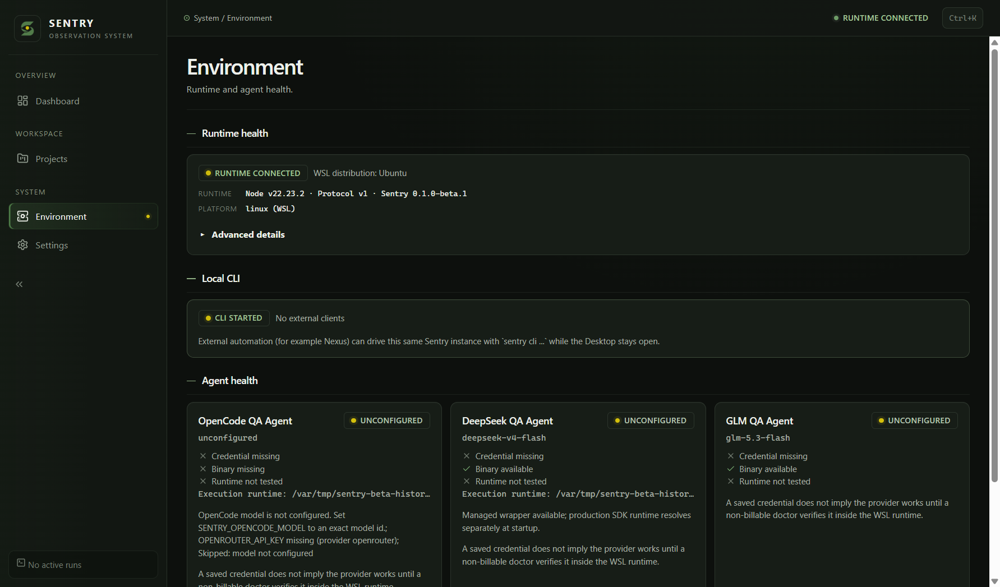

# Phase 5 actual acceptance campaign — 2026-10-13

Historical D/W1/C1 campaign receipt. Current integrated follow-up is the
[separate I1 / Phase5.1 receipt](v1-post-merge-acceptance-c78faa7.md), after
owner-merged PR16/17. This document's source, archives, counts and G10 failure
remain historical evidence; they are not reassigned to I1.

**Phase 6 is not recommendable or authorized.** Prepared-host Windows execution
produced real positive evidence, but G10 reproduced a P1 historical-beta rollback
credential-availability failure. Native CachyOS, clean Windows provisioning,
funded QA and active-work recovery remain incomplete. This documentation branch
contains no production correction and does not close Phase 4 or Phase 5 acceptance.

## A. Repository baseline

The primary checkout remained on local main
`9c57e3f78164c45c35316ae7bf2fe45fa4b0f132` with pre-existing owner modifications.
Those changes were not reset, stashed, committed or included. The clean existing
task checkout began this campaign at PR14 head
`42c484874e74e9544bdd1c035e5bfd02b0e27237`, then created
`test/v1-owner-acceptance-evidence` from fetched origin/dev. No open PR existed
at campaign baseline; the evidence PR is separate from the tested binary source.

| Reference                                     | Verified value                             |
| --------------------------------------------- | ------------------------------------------ |
| origin/main                                   | `4fd2be9fa3b17370841dbb1d2f0422a2150c62d8` |
| origin/dev; selected full candidate SHA       | `d250e4cabdae7735af5905146db8d7806fe4427c` |
| Candidate tree; PR14 source tree              | `a86a2c8ea160eef13cb2783568594de10955d158` |
| PR14 source                                   | `42c484874e74e9544bdd1c035e5bfd02b0e27237` |
| Beta annotated tag object                     | `e92e3be8d2de21ce5c22508c15de3c08f02cb77a` |
| Beta peeled source                            | `0e5c10cfa80f6385ebfc88a7306b38ce8a12ce38` |
| Product / Desktop / runtime version; protocol | `0.1.0-beta.1`; `1`                        |

[PR14](https://github.com/Mert1026/Sentry/pull/14) was merged by the human owner
at `2026-10-13T07:42:34Z`. The PR source and actual integrated tree are identical
(`git diff --exit-code` empty), while their commits remain distinct.
[Post-merge CI38364397137](https://github.com/Mert1026/Sentry/actions/runs/38364397137)
completed SUCCESS at the selected full SHA: quality, launcher (windows, no WSL),
launcher (linux, no CachyOS) each SUCCESS. Hosted quality used the explicit
sandbox-trust-unverified lane; its full-trust step was skipped. Real WSL trust
was rerun separately at the integrated SHA, 8/8 PASS. No native CachyOS inference.
The beta remains the October 9 prerelease with no assets; tag/release unchanged.

## B. Exact artifacts and retention

All selected archives were built from the full candidate SHA above. Root,
Desktop and runtime-source manifests agree on SHA/version/protocol. Unsigned
checksums establish integrity, not publisher authentication. The local and CI
Windows builds have the same filename but **different bytes and receipts**.

| Label / archive                                             | Actual SHA256                                                      | Verification / retention                                                                                                                                                        |
| ----------------------------------------------------------- | ------------------------------------------------------------------ | ------------------------------------------------------------------------------------------------------------------------------------------------------------------------------- |
| W-local: `sentry-0.1.0-beta.1-d250e4cabdae-windows-x64.zip` | `01e6590c78f6456ee7a4c273ac76369e42d1d17fc0b817f2dcbb28fc3accc7c6` | Native Windows clean-SHA build; sidecar, extraction, version, inventory332 PASS. This exact archive supplied W1 GUI/DPAPI tests. Retained privately in `dist/distributions`.    |
| W-CI: `sentry-0.1.0-beta.1-d250e4cabdae-windows-x64.zip`    | `323accdcdc6ff81bb41defc9aa981939fd00eea5a1698712b06fcc84b8635ee9` | Download, sidecar, extraction, version, inventory332 PASS. No physical GUI acceptance transferred from W-local. Retained in `dist/owner-campaign/ci-windows-x64`.               |
| C-CI: `sentry-0.1.0-beta.1-d250e4cabdae-cachyos-x64.tar.gz` | `216feca40136f64a101e63fbc20d44e04eca293496027cdae21d2618acca2d9e` | Download, sidecar, extraction, version, inventory333 PASS under WSL. Selected native operator archive, not native acceptance. Retained in `dist/owner-campaign/ci-cachyos-x64`. |

[Distribution38366622239](https://github.com/Mert1026/Sentry/actions/runs/38366622239)
was dispatched on dev and verified to have the exact selected head; both archive
jobs SUCCESS. W-CI artifact11797412454 created `2026-10-13T08:07:29Z`, expires
`2026-10-20T08:07:23Z`; C-CI artifact11796573381 created
`2026-10-13T08:05:40Z`, expires `2026-10-20T08:05:35Z`. Archive checksums above
are not GitHub artifact-wrapper digests. Private local copies and sidecars are
already retained locally independently of service expiry; they are not a published release.

Previously preserved PR-head artifacts remain separately under
`dist/owner-acceptance`, each independently rehashed against its sidecar:

| Source / archive                                                                                | Actual SHA256                                                      |
| ----------------------------------------------------------------------------------------------- | ------------------------------------------------------------------ |
| `42c484874e74e9544bdd1c035e5bfd02b0e27237` / `sentry-0.1.0-beta.1-42c484874e74-windows-x64.zip` | `aa25c6da42168a354b7fb83320370df77463bf469ab93b7864418d74523a5b23` |
| Same PR-head / `sentry-0.1.0-beta.1-42c484874e74-cachyos-x64.tar.gz`                            | `9753481cbaae1054193f552b537b51dea815ce372150a74fd06f06042c2977dc` |

Their [run38362558115](https://github.com/Mert1026/Sentry/actions/runs/38362558115)
expires October20. They were preserved, never relabeled as integrated D builds.

## C. Windows execution and sanitized evidence index

[W1 per-case receipt](v1-owner-acceptance-w1-d250e4c.md) derives from the existing
72-row template and includes all 61 applicable cases. W1 is actual Windows11
Home x64 build26200 with WSL2 Ubuntu26.04 LTS, kernel6.6.87.2-microsoft-standard-WSL2.
Windows build Node24.13.1, Linux standalone Node22.23.2, pnpm9.12.3,
Electron36.2.1; real running systemd user manager, bubblewrap and socat.
Actual same-account Windows DPAPI was used. No disposable Windows OS account
or clean VM was available.

Only task-owned Linux HOME/data roots and explicit Electron user-data-dir
profiles were used. Profile identity was proved before credential/project IPC.
Provider environment was cleared and no paid call occurred. Full Windows
`sentry.ps1 setup` was not run: distro preference synchronization would touch
the default owner profile. The real archived Linux bootstrap and real packaged
Electron were executed safely with isolated overrides. APPDATA alone was not
treated as Electron known-folder isolation. No security sandbox was disabled.

The following sanitized observations are public evidence. Private raw logs are
retained locally under ignored `.superharness` and `dist/owner-campaign`; their
basenames identify receipts, not public attachments. Sensitive absolute paths,
credential stores and raw CDP responses are excluded.

| Evidence   | Actual command/action, result and private receipt                                                                                                                                                                                                                                                                                                                                                                                                                                                        |
| ---------- | -------------------------------------------------------------------------------------------------------------------------------------------------------------------------------------------------------------------------------------------------------------------------------------------------------------------------------------------------------------------------------------------------------------------------------------------------------------------------------------------------------- |
| W-INT      | Clean-SHA `pnpm distribution:build windows-x64` succeeded (20 uncached build tasks). `Get-FileHash`, extraction, packaged `version` and inventory succeeded. 332 resources, all identities equal D. Disposable archive byte flip mismatched trusted SHA; no extraction. Three separate extraction copies (edited listed file, extra file, semantic identity mismatch) each rejected by packaged `version` with exit1. Original hashes unchanged; no private inventory names. `acceptance-integrity.log`. |
| W-INSTALL  | Archived `bootstrap-runtime.sh wsl` twice with isolated child HOME; frozen install/build and candidate/active hello each exit0. Distinct validated runtime targets, first target retained, existing-data marker unchanged. `acceptance-wsl-install-output.log`. Full Windows setup and preference persistence NOT RUN.                                                                                                                                                                                   |
| W-PREREQ   | Actual archived bootstrap in isolated PATH: absent Node and absent pnpm each nonzero with explicit Node>=22 / pnpm9.12.3 guidance, no current activated. Repaired direct WSL versions22.23.2/9.12.3. `acceptance-prereq-negative-output.log`. Actual systemd/bwrap/socat worked; missing-sandbox repair scenario NOT RUN.                                                                                                                                                                                |
| W-GUI      | Actual extracted production executable/preload/renderer, cwd outside checkout and path with spaces; Node unavailable in renderer, exact Linux hello D, project import/doctor ready, revision hash stable after deliberate source mutation, loaded Environment and History, second-instance exclusion, graceful close/reopen all PASS. `acceptance-outside-checkout.log`; `acceptance-ui-recovery-attempt4.log`. Managed revision observation does not prove a paid QA snapshot.                          |
| W-SEC      | Unchanged secure-settings helper: beta seeded synthetic DPAPI credential; candidate reported stored/secure, restart and strict standalone diagnostic exit0. Synthetic value absent in persistence/log/status scans; held-profile diagnostic refused read-only. Extended GUI presence-only status scan clean. `acceptance-secure-beta-upgrade.log`, `acceptance-ui-recovery-attempt4.log`.                                                                                                                |
| W-DIAG     | Second empty explicit profile diagnostic exit0 with all credential-presence booleans false. Separate corrupt disposable store strict diagnostic exit1 with sanitized unavailable guidance and no presence output. Original/corrupt stores unchanged. `acceptance-credential-diagnostics.log`. Actual unavailable DPAPI backend was not induced.                                                                                                                                                          |
| W-MISMATCH | Candidate Desktop paired with beta runtime rejected release identity and exposed no window.sentry bridge. Matching candidate later opened successfully. `acceptance-mismatched-runtime-attempt2.log`.                                                                                                                                                                                                                                                                                                    |
| W-RECOVERY | activeRuns was empty; SIGTERM targeted exactly one task-owned node matching both private runtime entry and data-root. Desktop observed disconnected; manual close/relaunch restored handshake and seeded history. Maintenance refused a running idle test runtime without mutation. `acceptance-ui-recovery-attempt4.log`, `acceptance-maintenance-idle-runtime.log`. No active-QA cancellation, interruption or maintenance proof.                                                                      |
| W-HISTORY  | Published-beta implementation seeded fresh synthetic history. Actual beta → candidate reopen retained completed run/finding/evidence/issue/retest and same-account credential; read-only backup/restored counts recorded in correction proposal. `acceptance-beta-prepare-output.log`, `acceptance-secure-beta-upgrade.log`, `acceptance-history-counts-output.log`. Existing exports and all preferences not exercised.                                                                                 |
| W-ROLLBACK | Matching stopped backup restored with beta binary/runtime. Credential configured false, candidate control true, beta repeat false; ciphertext unchanged, historical rows readable. Initial assertion exit1 retained. `acceptance-upgrade-rollback.log`, `acceptance-rollback-independent.log`. G10 FAIL; see correction proposal.                                                                                                                                                                        |
| W-TRUST    | Exact integrated candidate checkout, `pnpm --filter @qa/run-engine exec vitest run tests/verification-trust.test.ts --maxWorkers=1 --minWorkers=1`: exit0, 8/8 PASS9.64s using real systemd sandbox. `acceptance-integrated-linux-verify-output.log`.                                                                                                                                                                                                                                                    |

Retained test-harness failures: extended UI attempts1/2 timed out on a
case-sensitive expectation while actual rendered text was uppercase; live
observation showed connected and attempts3/4 used case-insensitive loaded-page
checks and passed. Mismatch attempt1 evaluated before DOM readiness and hit a
Windows WebSocket cleanup assertion; readiness polling/awaited close fixed only
the private observer, attempt2 passed. Initial FAIL logs remain; these are not
production defects or overwritten runs. G10 FAIL was independently reproduced
and has no passing rollback retest.

## D. Native CachyOS

[C1 receipt](v1-owner-acceptance-c1-d250e4c.md) includes all 58 applicable cases;
native host access is ENVIRONMENT UNAVAILABLE. [Executable operator handoff](v1-owner-acceptance-cachyos-handoff.md)
identifies C-CI, prerequisites, commands, secure-storage checks, independent
eight-case native sandbox results and sanitized evidence collection. WSL extraction
and trust successes do not satisfy any native host row.

## E. Funded acceptance

No agent-initiated provider execution was authorized or performed. The initial
campaign awaited an owner log. Subsequently the owner supplied a completed
Windows/WSL Full all-three export:3/3 completed,10 findings,38 evidence;609
existing-schema record checks and checked ownership/event relationships passed.
See the separate [owner-run receipt](v1-owner-run-01M4T9XG-acceptance.md). E07-Full
remains OWNER ACCEPTANCE REQUIRED for the selected candidate: the export omits
Sentry build/archive identity and does not independently establish snapshot-byte
immutability, DB/log/reopen equivalence or global duplicate-provider-call absence.
A successful E07-Full alone cannot pass the other13 cases or active-work failure
scenarios. No models, account labels, budget or agent spending scope was inferred.

## F. Recovery, upgrade and rollback

Idle runtime disconnect/manual relaunch and graceful repeated Desktop reopening
passed on W1. Linux first/repeated staging component passed. Synthetic historical
records and real DPAPI credentials survived beta → candidate. Full Windows setup,
active-work cancellation/maintenance/retest, populated export preservation,
post-activation failure and complete repair remain unexecuted. The controlled
matching-backup beta rollback failed credential availability; historical rows and
ciphertext survived. The affected track is stopped.

## G. Defects and limitations

One reproduced **P1 release-gate blocker**, [G10 rollback credential availability](v1-beta-rollback-credential-proposal.md).
Beta loads credentials before Electron readiness; D already has the correction.
No new D production regression or P0 was demonstrated. A separate bounded
proposal is prepared; no frozen source changes, tag changes or workaround
acceptance were made. Native CachyOS/clean-VM/backend-unavailable tests are
environment gaps. Remaining provider/active-work tests await owner execution.
Private
observer failures above are test-harness issues, retained separately.

## H. Gate assessment

Evidence-branch verification: repository hygiene, whole-repository formatting,
diff whitespace, template-derived W1/C1 ID coverage, canonical verdicts, full
per-row SHA/archive/checksum, local links and sanitized-text checks PASS. All
three native operator Bash blocks passed `bash -n` under WSL; this is syntax
validation, not native command execution. The actual screenshot was visually
reviewed before inclusion. No production paths changed. The evidence PR's own
head/proposed-merge checks are separate GitHub receipts and do not change the
selected D binary identity or imply new host acceptance.

| Gate                  | Verdict                   | Supporting evidence                                                                                    |
| --------------------- | ------------------------- | ------------------------------------------------------------------------------------------------------ |
| Implementation        | PASS                      | PR14 integrated, reviewed source tree unchanged; historical beta rollback limitation separately failed |
| Automated validation  | PASS                      | Three exact-D post-merge CI jobs; hosted trust unavailable disclosed; actual integrated WSL8/8         |
| Artifact verification | PASS                      | W-local/W-CI/C-CI full SHA, trusted sidecars, extraction/inventory/version                             |
| Windows acceptance    | BLOCKED                   | Prepared-host positive cases; complete provisioning/recovery gaps and G10 FAIL                         |
| CachyOS acceptance    | ENVIRONMENT UNAVAILABLE   | No native host; C1 receipt and operator handoff                                                        |
| Credential continuity | BLOCKED                   | W1 DPAPI upgrade/restart PASS; beta rollback FAIL; native backend unavailable                          |
| Funded multi-agent QA | OWNER ACCEPTANCE REQUIRED | Owner Windows3/3 export audited; selected build/remaining E07 evidence and other13 cases open          |
| Upgrade/rollback      | FAIL                      | W-ROLLBACK independent beta/candidate/beta reproduction; G10 P1                                        |
| Owner approval        | OWNER ACCEPTANCE REQUIRED | No freeze acceptance or Phase6 authorization                                                           |

## I. Decision

1. D is technically ready for further supported-host testing; beta rollback must
   remain stopped pending owner disposition.
2. Exact artifacts, prepared W1 packaged GUI/IPC/DPAPI/history, integrity negatives,
   missing Node/pnpm, isolated Linux staging, idle recovery and real WSL trust ran.
3. Clean Windows setup/prerequisite matrix, native CachyOS, secure-backend failure,
   complete funded matrix/E07 attribution, active-work recovery and full upgrade/repair/export cases remain.
4. No new D regression was reproduced; a historical beta defect newly failed the
   mandatory rollback gate and blocks acceptance.
5. **No Phase6 recommendation** while that failure and mandatory gaps remain.
6. **No owner authorization for Phase6.** No RC branch, merge, version/tag change
   or official release publication occurred. The evidence PR targets dev for review.
