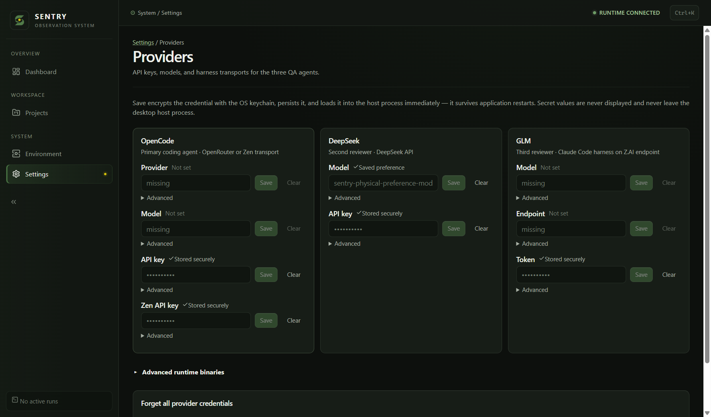

# Phase 5.1 integrated acceptance baseline — 2026-10-13

**Technical baseline verified; release acceptance remains incomplete. Phase 6
NOT AUTHORIZED.** This receipt selects integrated source I1 for this bounded
campaign. It neither relabels the historical D/520 binaries nor changes the
frozen W1/C1 results. No production change was justified by the integrated audit.

## A. Repository and implementation

Fresh fetch/prune confirmed `origin/dev` at
`c78faa74717b0f430a859730e98c3c4915e7b03f`, tree
`8bbaab4a5d1f7830dcf4ed7b4c40362c62f8d71d`.
`origin/main` remains `4fd2be9fa3b17370841dbb1d2f0422a2150c62d8`.
The dirty owner's primary checkout at local main `9c57e3f` was preserved;
the clean existing task worktree was reused on `fix/v1-post-merge-acceptance`.
No open PR existed at baseline. Last ten dev commits, all remote branches,
worktrees, tags, published release and both active workflows were inspected.

| Integration                                        | Verified actual merge                      | Head merged                                | Result                          |
| -------------------------------------------------- | ------------------------------------------ | ------------------------------------------ | ------------------------------- |
| [PR17](https://github.com/Mert1026/Sentry/pull/17) | `202577e56726f6a8c4cb0b89703a0ee36adf0018` | `8ab68f9010e0a6bdc1c78aa0d4699cf96c2dc8ec` | MERGED, 2026-10-13 14:08:00 UTC |
| [PR16](https://github.com/Mert1026/Sentry/pull/16) | `c78faa74717b0f430a859730e98c3c4915e7b03f` | `de4f40b8e2f1c36d53685a4168694aff210b05f4` | MERGED, 2026-10-13 14:14:34 UTC |

PR16's head includes its merge of dev; its earlier `9595345` evidence commit
is not the final merged head. Both actual merges and task heads are reachable
from I1. [Post-merge CI38411670558](https://github.com/Mert1026/Sentry/actions/runs/38411670558)
is completed SUCCESS at I1: quality, launcher (windows, no WSL), launcher
(linux, no CachyOS) each SUCCESS. Hosted quality used the explicitly
sandbox-trust-unverified lane; real WSL trust was separately executed below.

The integrated `apps`, `packages`, lockfile and distribution scripts have no
diff from credential implementation `5207288`. This equivalence explains the
expected behavior; the new tests and binaries below establish evidence for I1.
Review traced provider-credentials, bootstrap, index, desktop-service, Providers
and all three new PR17 regression files, existing redaction and secret surfaces.

The complete save path validates input, checks live crypto availability, reads
the version-1 encrypted store, encrypts the replacement, preserves untouched
entries, and writes a unique temporary file then renames it. Only after rename
does it publish memory/environment/stored status; the application service then
pushes configuration through the existing main-to-runtime boundary. Rejected
encrypt/write/clear operations preserve old state. A serial mutation queue
prevents overlapping read/modify/write loss and survives rejection.

Index waits for Electron readiness. Packaged default profile selection maps to
the existing source profile under appData/@qa/desktop; explicit user-data-dir
wins. Bootstrap passes that same selected directory to credentials and host,
and refuses unresolved profiles before storage/runtime I/O. Stored memory takes
precedence over an inherited environment value in runtime configuration; an
environment-only credential is explicitly labeled From environment. Secrets
never cross status IPC; model preferences remain a separate non-secret file.

Normal load distinguishes missing entries, unreadable entries/stores and
unavailable crypto. Strict diagnostics fail closed without migration. Legacy
migration uses committed saves, retains failed input and does not overwrite an
unreadable current entry. Renderer query failure hides cached status and shows
an error/retry, never Not set. Failed saves clear previous success notices.
No plaintext fallback, schema, model/provider, orchestration, protocol or
historical-data changes were introduced. No new reproduced production defect.

## B. Executed automated verification

All rows here target full I1 source, not an assumed result inherited from PR17.
Raw logs remain private/ignored; basenames identify retained receipts.

| Gate / actual command                                                                                       | Result           | Evidence                                                                                 |
| ----------------------------------------------------------------------------------------------------------- | ---------------- | ---------------------------------------------------------------------------------------- |
| WSL `pnpm install --frozen-lockfile`                                                                        | PASS             | phase51-linux-verify.log                                                                 |
| WSL `pnpm repository:check`, `pnpm format:check`                                                            | PASS             | Same receipt                                                                             |
| WSL `pnpm lint`, `pnpm typecheck`, `pnpm build`                                                             | PASS             | 20 / 37 / 20 successful tasks                                                            |
| Windows frozen install; `pnpm --filter @qa/desktop exec vitest run --maxWorkers=1 --minWorkers=1`           | PASS; 2 SKIPPED  | 400 tests passed, 51 files; phase51-desktop.log                                          |
| WSL `pnpm exec turbo run test --force --concurrency=1 -- --maxWorkers=1 --minWorkers=1`                     | PASS; 16 SKIPPED | 40 uncached tasks, 1,236 passed; Desktop401/1; phase51-linux-verify.log                  |
| WSL focused credential/profile/status/redaction/secret-surface/quit/userData/bootstrap files, serial vitest | PASS             | 65/65 across8 files; phase51-focused-trust.log                                           |
| WSL separate `@qa/run-engine` verification-trust.test.ts, serial vitest                                     | PASS             | Real systemd sandbox8/8; phase51-focused-trust.log                                       |
| `git diff --check`                                                                                          | PASS             | Clean selected-source check; final documentation check also required                     |
| I1 Windows native distribution build                                                                        | PASS             | 20 uncached builds, verified extraction/inventory332; phase51-windows-build.log          |
| I1 hosted Windows and CachyOS-targeted distribution jobs                                                    | PASS             | [38417470244](https://github.com/Mert1026/Sentry/actions/runs/38417470244), both SUCCESS |

Windows tests used a fresh TEMP/TMP and cleared managed secret/live-test variables.
The focused WSL rerun used a fresh TMPDIR and cleared those variables. The full
WSL procedure reused the prepared clean Linux clone and fetched I1 from the
shared Git repository, never the owner's working-tree files. Opt-in live and
platform skips are reported, not treated as passes. No paid calls were started.

## C. Exact unsigned candidate

All I1 artifacts identify full source `c78faa74717b0f430a859730e98c3c4915e7b03f`
and tree `8bbaab4a5d1f7830dcf4ed7b4c40362c62f8d71d`; product/Desktop/runtime
version `0.1.0-beta.1`, runtime protocol1. Each was built from a clean committed
input with the existing `pnpm distribution:build <target>` tooling. Root,
Desktop and runtime-source build-identity.json agree with distribution.json.

| Artifact / build host                                                                  | Archive SHA256                                                     | distribution.json SHA256                                           |
| -------------------------------------------------------------------------------------- | ------------------------------------------------------------------ | ------------------------------------------------------------------ |
| `sentry-0.1.0-beta.1-c78faa74717b-windows-x64.zip`, native Windows physical-test bytes | `ec5edec8a6b3f8ef18bafd961e66c59f80669804cc98d30e0cb10ef18c527d1e` | `cd8f0a536e1e76a89413826f5c5367f40f99e3c2817106c81bbd8932698a6cdc` |
| Hosted Windows same filename, separate retained CI bytes                               | `1343b80a5c7ea29a795f84f0a6b0ae226f46bf5e5f7781170e1d9d934bafe879` | `7d82d24e4c2949b84e2af62a4c8d8dec42d8b421babe7bba2fc2cda9f2025954` |
| `sentry-0.1.0-beta.1-c78faa74717b-cachyos-x64.tar.gz`, hosted Ubuntu Linux build       | `5bd3642ed392607a010078be35885d1cff45db162a2841ee374be228275e89d8` | `e79b4d8836394c6cfc87c573b71d1e500f3334cc5d7947c4daf07dcef3ae9a86` |

Native Windows command: `pnpm distribution:build windows-x64`, Node24.13.1,
pnpm9.12.3, Electron36.2.1. Hosted commands use Node22/pnpm9.12.3 and
`windows-x64` / `cachyos-x64` respectively. Build input guards, archive SHA256
sidecars, extraction and `scripts/distribution/verify.mjs` check actual bytes,
file inventories and identity, not filenames alone. Hosted Ubuntu packaging
does not establish native CachyOS execution. CI review artifacts expire after
seven days; local copies are retained separately from old D/520 artifacts.
Physical evidence below applies only to the native Windows hash above.

Both downloaded hosted archive hashes match their SHA256 sidecars. Separate
extractions passed verify.mjs: Windows332 files; CachyOS-targeted333 files.
I1 distribution artifact IDs: Windows11824624394, CachyOS11824114212; expiry
2026-10-20 15:00:02 / 14:57:32 UTC respectively. Extraction receipts and archives
are retained privately. First CachyOS extraction invocation lost its shell
argument and tar refused the empty filename; the corrected external script
extracted the same verified bytes successfully, without any source change.

## D. Packaged Windows acceptance (W2 / I1)

E1/E2/E3 here are Phase5.1 stages, not funded QA matrix case IDs. Host is prepared
Windows/WSL Ubuntu, same Windows account, real Electron DPAPI; this is not a
clean Windows VM. Matching I1 runtime was built from this archive's runtime-source
using unchanged deploy-inner.sh stage-only in a disposable Linux HOME. Runtime
hello verified full I1 SHA/version/protocol. No owner's runtime/current changed.

Procedures reuse scripts/distribution/smoke.mjs with private acceptance
assertions: all four secret fields, exact synthetic model preference, actual
Providers badges and screenshot. Each launch proves the explicit profile from
its DevToolsActivePort before credential IPC, clears inherited managed provider
variables, isolates TEMP/TMP/APPDATA and uses production preload/renderer/main
service. No sandbox is disabled. Synthetic secrets remain private.

| Stage / observation                                                                                                                                                      | Result                    | Private receipt                                                                         |
| ------------------------------------------------------------------------------------------------------------------------------------------------------------------------ | ------------------------- | --------------------------------------------------------------------------------------- |
| E1 fresh profile; four synthetic secret fields saved through real application service                                                                                    | PASS                      | phase51-dpapi-fresh.log                                                                 |
| E1 full Desktop/runtime shutdown, two new-process relaunches; all four configured=true, persistence=secure, source=stored                                                | PASS                      | Same receipt, three successful processes                                                |
| E1 exact non-secret DeepSeek model preference retained; actual four Stored securely badges, blank drafts; presence-only diagnostic                                       | PASS                      | Same receipt; screenshot below                                                          |
| E1 synthetic plaintext absent in disposable profile, app output and extracted archive; diagnostic refused while Desktop held profile, succeeded after shutdown           | PASS                      | Same receipt                                                                            |
| E2 second empty profile seeded by D (`d250e4c`, Windows hash01e6590c…); four keys AND model preference, full stop, I1 reload twice                                       | PASS                      | phase51-dpapi-compat.log                                                                |
| E2 encrypted store and model preference bytes unchanged after both I1 launches; no redirection/plaintext                                                                 | PASS                      | Same receipt                                                                            |
| E3 actual Windows file-share lock rejects atomic replacement and new secret save; real Save UI reports failure, no stale success                                         | PASS                      | phase51-dpapi-faults.log                                                                |
| E3 rejected-save fresh restart; corrupt DPAPI entry unavailable, other stored entry readable/preserved; unreadable store refuses overwrite; stopped restoration recovers | PASS                      | Same receipt                                                                            |
| E3 unavailable crypto and status-query failure/retry                                                                                                                     | PASS, CONTROLLED ONLY     | Existing regressions, including cached-query failure; not physical DPAPI unavailability |
| D07 separate empty profile; all four prior-profile secrets absent, missing status truthful                                                                               | PASS                      | phase51-dpapi-empty.log                                                                 |
| Actual backend-unavailable supported session (D06); native CachyOS/keychain                                                                                              | ENVIRONMENT UNAVAILABLE   | No qualifying host/session available                                                    |
| E4 owner's existing real profile                                                                                                                                         | OWNER ACCEPTANCE REQUIRED | No real profile accessed; procedure below                                               |

Screenshot SHA256 `22c0e9729f0c217b4e21615193b06674fb6092475e736bf3f2396413d3516f83`.
Visually inspected: four Stored securely labels, separate saved model preference,
no secret values or owner identifiers. Raw profile paths/stores/CDP responses
and unsanitized logs are excluded from committed evidence.

The failure-path script keeps a read-only Windows file handle denying rename
only on the disposable providers.json; it releases the lock before restart.
It privately compares original bytes, injects a non-decryptable synthetic blob,
verifies preservation while saving a different key, then tests malformed JSON
and restores the retained fixture only after full stop. Final observation found
no remaining I1 Desktop or task-owned runtime process. No owner's store, runtime
pointer or historical fixture was used for these mutations.

For W2/I1, D01–D03,D05,D07,D08 pass the exercised Windows synthetic scope. D04 covers
presence status, standalone diagnostics and application output; paid-run export
privacy remains part of the unexecuted provider campaign. B07's packaged identity/connected
runtime/Providers portion and B12's graceful exit/reopen/import portion pass;
complete B07 readiness and B12 populated-history comparison remain open.
G05 credential/preferences continuity is bounded evidence, **not a G05 PASS**:
full beta history/representative lineage/export-byte inventory was not rerun.
Historical D W1/C1 counts and G10 FAIL remain unchanged.

### E4 minimal owner procedure — requires explicit approval before execution

The owner controls the installed binary and profile. First record its displayed
source/version and archive checksum where available; never read/upload the
credential store. With no active QA, view Providers and record only each secret
field's badge (Stored securely / From environment / unavailable / Not set) and
whether the ordinary model preference is present. Do not Save, Clear, Forget,
change profile, migrate, run QA, or reveal/copy secrets. Stop normally, confirm
Desktop and owned runtime exited, reopen the same installation/account/profile,
and record the same presence-only observations twice. Report source identity,
badges and restart result only. Any unexpected warning/unknown identity stops
this acceptance attempt; investigate separately rather than rewriting settings.
Normal startup may perform its existing migration, so review that behavior and
the exact installed build before approving the observation. No agent real-profile
test is authorized by this document. E4 remains OWNER ACCEPTANCE REQUIRED.

## E. Remaining blockers and G10 disposition

| Category                     | Outstanding requirement                                                                                                                                    |
| ---------------------------- | ---------------------------------------------------------------------------------------------------------------------------------------------------------- |
| Reproduced production defect | No additional I1 defect reproduced in this bounded audit; owner's actual original trigger remains unattributed because real credentials were not inspected |
| Historical beta limitation   | G10 P1 FAIL: immutable beta loads credentials before app readiness; encrypted bytes/history survive, credential availability fails                         |
| Missing physical acceptance  | Clean Windows provisioning, populated history/export upgrade comparison, active-work cancellation/maintenance/recovery, remaining supported-host A–G cases |
| Missing owner authorization  | Real-profile E4, bounded paid-provider matrix and active-provider scenarios, rollback-target disposition, remote branch deletion, feature freeze / Phase6  |
| Environment unavailable      | Native CachyOS graphical/keychain acceptance, clean Windows VM/account, actual supported backend-unavailable D06 session                                   |
| Documentation/process issue  | Owner Full3/3 export lacks producing SHA/archive; private-plan branch-protection403; these cannot be inferred away                                         |

G10 evidence was reviewed again: stopped matching beta backup and independent
beta→D→beta yield configured=false→true→false with identical ciphertext and
readable historical rows. This shares the general startup-readiness area with
credential handling, but PR17 does not patch the immutable beta. Recommend the
bounded policy disposition in the [G10 proposal](v1-beta-rollback-credential-proposal.md):
explicitly versioned I1 Desktop/runtime recovery target with its own compatible
stopped backup, subject to owner approval and full G01–G10 retest. No replacement
rollback PASS or beta modification is claimed; a beta-derived recovery patch
would require separate authorization and a separate source/artifact identity.

## F. Branch hygiene

Fresh origin branches were checked with `git rev-list origin/dev..<branch>`;
all three yield zero unique commits and their tips are ancestors of I1.
There were no open PRs or repository workflow dependencies on those task names.
Historical receipts reference their immutable commits, which remain reachable.

| Remote branch / tip                                                                   | Merged PRs | Recommendation                                                           |
| ------------------------------------------------------------------------------------- | ---------- | ------------------------------------------------------------------------ |
| `fix/v1-pre-rc-acceptance-preparation` / `42c484874e74e9544bdd1c035e5bfd02b0e27237`   | 14         | Eligible for remote deletion after explicit owner approval               |
| `fix/v1-provider-credential-persistence` / `8ab68f9010e0a6bdc1c78aa0d4699cf96c2dc8ec` | 17         | Eligible after approval; local checkout was freed by the new task branch |
| `test/v1-owner-acceptance-evidence` / `de4f40b8e2f1c36d53685a4168694aff210b05f4`      | 15,16      | Eligible after approval; no unique work remains                          |

No branch/tag was deleted or force-updated. Existing local branches/worktrees
and private evidence remain available. GitHub main/dev protection API requests
both return403 requiring Pro/public; do not claim enforced protection. PR-only
integration, exact-SHA applicable checks, explicit owner approval and owner-only
merge remain procedural gates. The immutable beta annotated object
`e92e3be8d2de21ce5c22508c15de3c08f02cb77a` still peels to
`0e5c10cfa80f6385ebfc88a7306b38ce8a12ce38`; published prerelease has no assets.

## G. Review handoff

This PR contains acceptance evidence/documentation only. I1 is the selected
tested integrated source; the receipt commit and its CI/distribution builds
have separate identities and do not inherit I1 physical acceptance automatically.
Final review checks are recorded in the PR and final task report after completion.
Owner review is required; no self-merge, main change, RC/version/tag/release,
rollback implementation, paid execution or Phase6 action is authorized.
