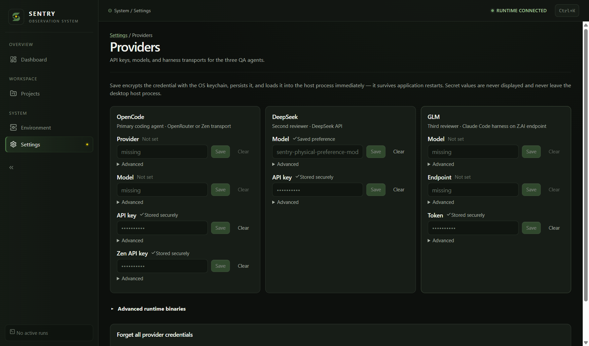

# Provider credential persistence correction

Historical correction receipt for implementation5207288. PR17 is now owner-merged
as `202577e56726f6a8c4cb0b89703a0ee36adf0018`; PR16 subsequently integrated
owner-run evidence at dev `c78faa7`. The [Phase5.1 receipt](v1-post-merge-acceptance-c78faa7.md)
records newly executed tests/artifacts/DPAPI acceptance on that integrated SHA.
The520 results and screenshot below retain their original binary identity.

Baseline: origin/dev `aef67903ac0ef1a42a5bf3ebd2626c4603152688`.
Branch: `fix/v1-provider-credential-persistence`, isolated task checkout; owner
primary checkout and acceptance branches preserved. This user report is separate
from G10 historical beta rollback. The selected D acceptance binaries remain
unchanged; any corrected binary is a new candidate requiring fresh acceptance.

## Investigation and bounded design

Four paths are investigated independently: write failure before restart; profile
resolution; stored-entry/backend load failure; renderer status-query failure.
Current index already awaits Electron readiness. No owner's actual credential
store is inspected to infer their specific trigger.

1. Source of truth: encrypted providers.json owns durable secrets; models.json
   owns existing non-secret preferences. Session environment is a distinct source.
2. Ownership: main-process credential service alone writes those files. Renderer
   holds input drafts and queries presence/status; runtime receives configuration
   through the existing main-process channel.
3. Dependencies: renderer consumes status IPC; application service uses credential
   service; credential service uses filesystem and injected secure-storage bridge.
   No new persistence subsystem, database ownership or reverse dependency.
4. Boundary: only configured/persistence/source/fixed error hints cross status
   IPC. No decrypted secret, ciphertext, I/O exception or profile path is returned.
5. Failure: publish memory/environment/stored state only after atomic encrypted
   write. Unreadable/unavailable storage is explicit; query failure is unknown,
   never missing. Preserve prior files/state on rejected operations.
6. Lifecycle: stable Electron userData chosen before bootstrap, crypto load after
   app-ready; no temporary profile fallback. Serialize mutations; a failed one
   cannot poison subsequent operations. Fresh restart must reload persisted bytes.
7. Test seams: actual application/credential services, isolated temporary profiles,
   controlled secure backend and filesystem failure fixtures; mounted renderer
   queries/mutations. Physical Electron DPAPI is a separate test, not mocked proof.
8. Compatibility: retain version1 encrypted stores, non-secret model preferences,
   explicit/default profiles and legacy migration. Preserve unreadable entries
   when another key is saved; refuse rewriting an unreadable store. No historical
   data/schema/runtime protocol/provider/model/orchestration changes.
9. Observability: fixed presence-only unavailable states and honest source labels,
   query-error/retry UI, sanitized save errors. Failed attempts retained in receipt.
10. Security: no plaintext fallback; no secret values in status/UI/errors. All
    tests use synthetic credentials in disposable profiles; owner stores untouched.

## Verification receipts

The actual application-service healthy save → shutdown → fresh-context load is
a passing baseline control. It clears managed environment variables before the
fresh context and verifies configured:true, persistence:secure, source:stored;
it does not mistake inherited process environment for durable storage.

| Investigation        | Reproduced baseline behavior                                                                                                                                                                  | Minimum correction                                                                                                                                                                                                 |
| -------------------- | --------------------------------------------------------------------------------------------------------------------------------------------------------------------------------------------- | ------------------------------------------------------------------------------------------------------------------------------------------------------------------------------------------------------------------ |
| Apparent persistence | Save RPC rejects a failed write, but memory/env and persistedSecrets were already changed; subsequent status falsely reports stored/secure. Failed replacement also changes the active value. | Serialize mutations, stage encrypted changes, await atomic write/rename, then publish memory/env/status. Fixed errors suppress backend exception text. Clear/forget use the same commit-before-publish discipline. |
| Profile path         | Valid source/packaged profile controls agree. Failed/empty Electron getPath was swallowed and could select shared temporary storage; no actual owner profile mismatch was observed.           | Require explicit stable profile for credential I/O; production bootstrap fails before credentials/runtime if profile resolution fails. Default packaged/source path and explicit profile selection remain intact.  |
| Load/decryption      | Normal startup silently turns unreadable entries/store or unavailable crypto into missing; saving another key can drop an unreadable entry.                                                   | Presence-only unavailable/error states; retain ciphertext of untouched entries, refuse rewriting unreadable stores, retain failed legacy migration inputs. Preferences still load separately.                      |
| Providers display    | Query failure/loading appears Not set; environment and plain preferences say Saved securely; failed save can retain an earlier success notice.                                                | Unknown/error/loading states with retry, Stored securely vs From environment vs Saved preference, clear success notices on failed/new mutations and refresh canonical status.                                      |

Exact owner-machine trigger remains unproven: no real credential store was read,
deleted, overwritten or decrypted. These are independently reproduced defects
matching the symptom class, not an assumption about an empty password input.
Current dev already awaits app-ready; the historical beta G10 cause is unchanged.

Private receipts: `credential-baseline-complete-red.log` runs exact baseline
production files against final regressions: **18 RED / 4 guard PASS (22 cases)**.
`credential-regression-complete-green.log`: **22/22 PASS** after correction.
`credential-focused-green-attempt2.log`:54 focused existing/new tests PASS.
`credential-desktop-full.log`: Windows Desktop **400 PASS / 2 existing platform
skips**,51 files. Desktop lint/typecheck, repository hygiene, whole-repository
format and diff whitespace PASS. Initial observer/test attempts are retained;
one test needed its Save button scoped to the specific credential field, and a
legacy failure guard exposed an additional swallowed migration failure that was
corrected. Final baseline RED and final GREEN use identical expectations.

Implementation changes only bootstrap profile resolution, the main credential
service and Providers presentation. index.ts readiness/profile selection and
DesktopApplicationService's awaited save → runtime configuration flow were traced
and remain unchanged. Runtime configuration only follows a successful durable
save. No provider orchestration, models, runtime protocol, history or DB changes.

Implementation source: `5207288292a6b2421495b7cb94881a1bd0f2e61f`.
Subsequent receipt commits change documentation/evidence/protocol records only;
their CI/artifact identities are separate from this physically tested archive.

| Exact-source gate                                  | Actual result / evidence                                                                                                                                                                                                                                                                                                                                            |
| -------------------------------------------------- | ------------------------------------------------------------------------------------------------------------------------------------------------------------------------------------------------------------------------------------------------------------------------------------------------------------------------------------------------------------------- |
| Native Windows unsigned build                      | PASS:20 uncached build tasks; `sentry-0.1.0-beta.1-5207288292a6-windows-x64.zip`, SHA256 `733b82b18c26d1a852aa6660804a96d3680b97466431324ef82b8cced698dd51`                                                                                                                                                                                                         |
| Archive/extraction identity                        | PASS: locally built ZIP rehashed against original sidecar, extracted outside checkout into path with spaces; root/Desktop/runtime manifests match full520 source; inventory332/version PASS                                                                                                                                                                         |
| Versions / protocol                                | Product, Desktop and runtime remain0.1.0-beta.1; protocol1. No published tag or frozen D artifact was changed.                                                                                                                                                                                                                                                      |
| Windows exact-source Desktop                       | PASS:400 tests / 2 existing platform skips,51 files (`credential-desktop-exact-source.log`)                                                                                                                                                                                                                                                                         |
| Exact-source WSL frozen/static/build               | PASS: frozen install, hygiene/format, lint20 tasks, typecheck37, build20 (`credential-linux-verify-output-attempt2.log`)                                                                                                                                                                                                                                            |
| Exact-source WSL full tests                        | PASS: `pnpm exec turbo run test --force --concurrency=1 -- --maxWorkers=1 --minWorkers=1`;40 uncached tasks,1,236 tests PASS / 16 opt-in/platform skips; Desktop401/1 skip; actual systemd sandbox trust8/8 PASS                                                                                                                                                    |
| Actual packaged Electron/DPAPI                     | PASS: Windows11 Home x64 build26200, Electron36.2.1, WSL2 Ubuntu26.04 / Node22.23.2. Saved four synthetic secret fields, fully stopped Desktop/runtime, relaunched twice with cleared provider env. Every field reports configured:true/persistence:secure/source:stored; actual Providers shows Stored securely. Non-secret model preference persisted separately. |
| Physical privacy/readiness                         | PASS: explicit disposable profile proved before credential/project IPC; renderer Node disabled, sandbox enabled, full520 runtime handshake, synthetic plaintext absent in profile/archive/output, held-profile diagnostic safely refuses; fresh standalone presence diagnostic and normal reopen PASS                                                               |
| Prior encrypted-store compatibility                | PASS: actual D archive `d250e4cabdae7735af5905146db8d7806fe4427c` seeded a separate synthetic DPAPI profile; full shutdown →520 load →full shutdown →520 reopen retained stored/secure credential (`credential-dpapi-upgrade-real.log`). This is credential compatibility, not complete historical-data/export upgrade acceptance.                                  |
| Native CachyOS/keychain / real backend unavailable | ENVIRONMENT UNAVAILABLE; controlled-backend tests are not physical native keychain or actual unavailable-DPAPI proof                                                                                                                                                                                                                                                |

Physical receipts: `credential-dpapi-real.log` has three successful actual
production-entry processes, with all four secret fields verified after each
restart and the actual Providers badge observed; `credential-stage-runtime-output.log`
stages an exact520 runtime with unchanged deploy-inner stage-only in a task-owned
Linux HOME and verifies hello. No owner's current pointer is activated/changed.
`credential-dpapi-upgrade-real.log` preserves the independent D→520 case. Both
profiles/data roots and raw receipts remain private; they contain synthetic data
only. The test does not treat blank password drafts as missing credentials.

Failed attempts retained: first WSL fetch used a Windows worktree .git path Linux
could not resolve; fetching the same exact commit from its shared main Git
repository fixed that validation-path issue, without changing owner files or
source. Initial RED/GREEN test receipts and the scoped-Save-button fixture repair
remain available privately. No failing assertion or production failure was waived.

Review: no remaining actionable correctness, data-loss/security, concurrency or
compatibility blocker found in the final diff. React review checked query states,
draft-only local state, query invalidation, accessible error/retry/source labels,
and no new dependencies or secret serialization. Successful saves publish only
after disk commit; failed writes preserve old active/durable state; ciphertext
read failures do not erase other entries. No credentials or project text appear
in the committed screenshot/receipt. New correction PR checks remain live receipts;
passing hosted jobs do not substitute for native keychain or future owner acceptance.

Affected owner acceptance: D01–D05,D07–D08 (secure save/reload/privacy/unreadable
status/profile/upgrade), B07/B12 (Providers truth/relaunch), G05 (credential
continuity); D06 needs an actual unavailable native backend session independently.
The Phase5.1 receipt evaluates these against newly selected integrated I1 bytes;
neither old D nor520 evidence is silently transferred. G10 historical beta rollback remains
FAIL; this correction does not modify or backpatch the immutable beta.
